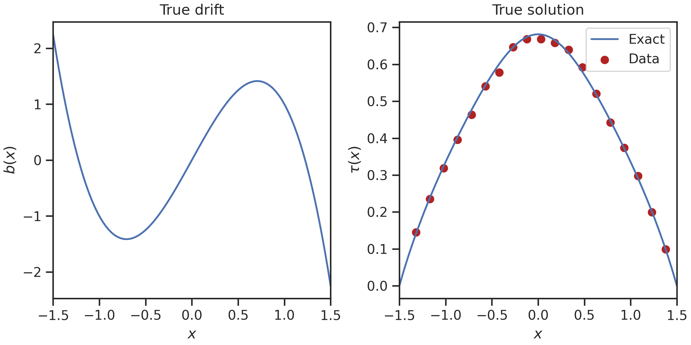
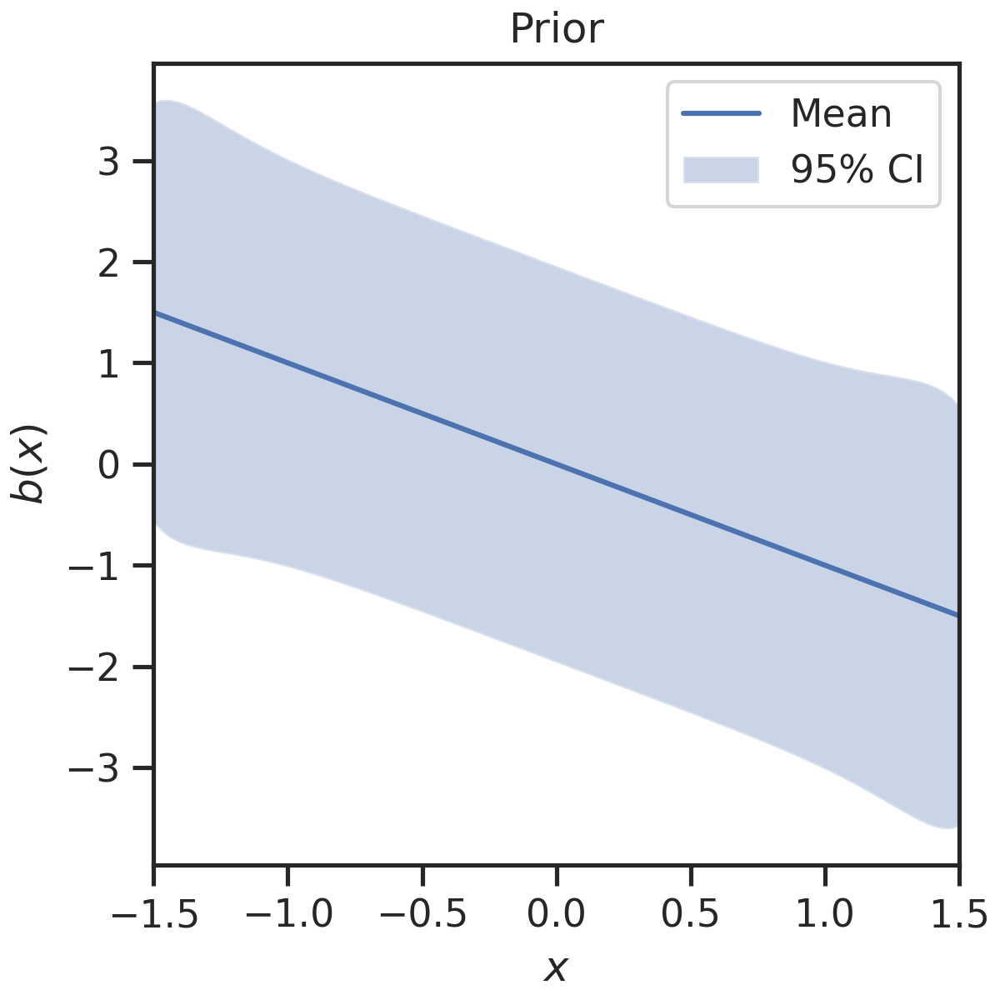
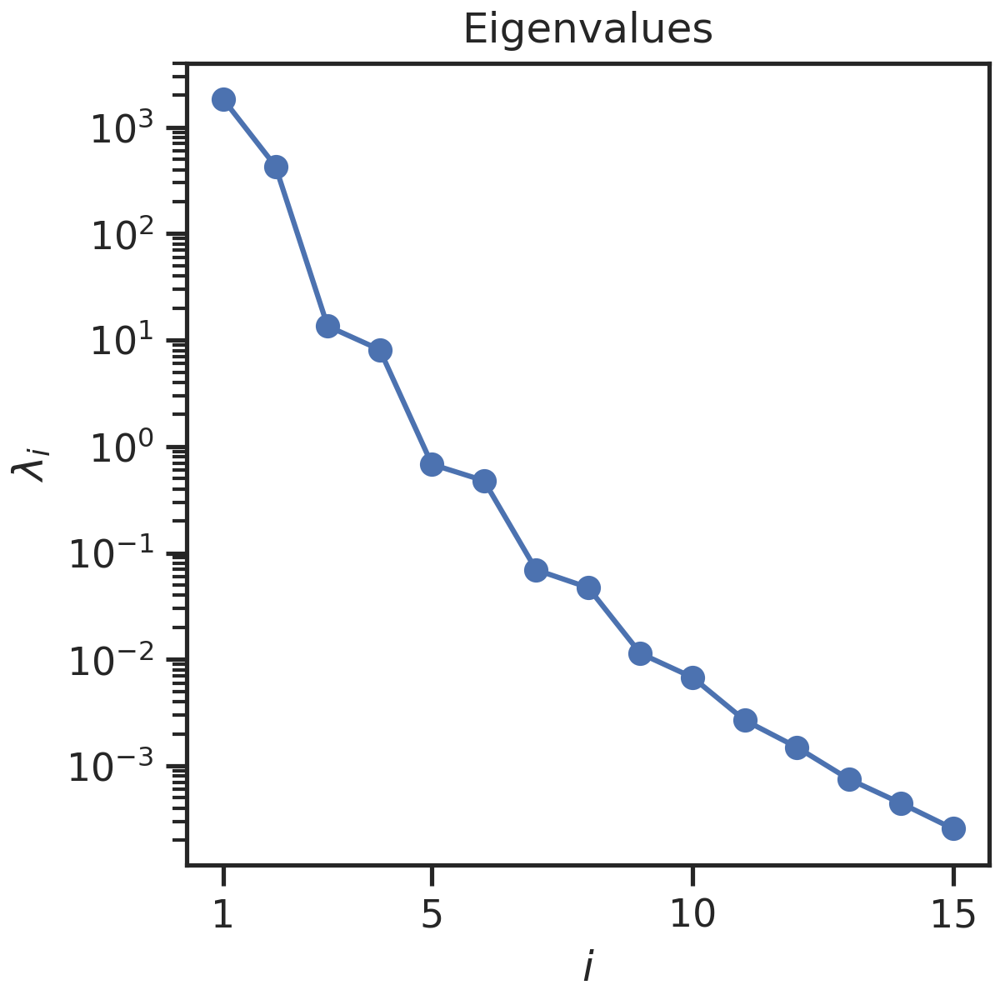
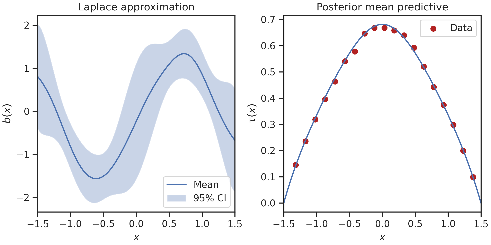

# Tutorial

To illustrate the usage of SPIN, we present in this tutorial a simple examplary inference use-case.
The problem under consideration deals with the inference of the drift function for a stochastic
process on a 1D domain $\Omega\subseteq\mathbb{R}$. We assume that such a process, indexed over
$t\in\mathbb{R}_+$, can be modelled by an SDE of the form

$$
    dX_t = b(X_t)dt + \sigma(X_t)dW_t,
$$

with scalar drift $b(x)$, diffusion $\sigma(x)$ and Wiener process $W_t$. Moreoever, we consider
the scenario where $\sigma$ is known and $b$ is to be inferred from data.

This data is assumed to be available in form of the mean first passage time (MFPT) of the process
from a bounded domain $\mathcal{A}\subset\Omega$. Recall that the first passage time of the process
from $\mathcal{A}$ is defined as

$$
    \tau(x) = \inf\{ t\geq 0: X_t \neq\mathcal{A}|X_0 = x \}.
$$

The MFPT is then given as $\tau_1(x) = \mathbb{E}[\tau(x)]$. A PDE model describing the MFPT in
terms of the drift and diffusion function can be deduced from the Kolmogorov backward equation.
Specifically, it holds that

$$
\begin{gather*}
    \mathcal{L}\tau_1 = -1,\quad x\in\mathcal{A}, \\
    \tau_1 = 0,\quad x\in\partial\mathcal{A},
\end{gather*}
$$

where $\mathcal{L}$ is the infinitesimal generator of the underlying process,

$$
    \mathcal{L} = b(x)\frac{d}{dx} + \frac{1}{2}\sigma^2(x)\frac{d^2}{dx^2}.
$$

In total, the goal of this tutorial is to showcase Bayesian inference of $b(x)$, given
(noise-polluted) data of $\tau_1$.

!!! info "Visualization code not shown"
    To make this tutorial more concise, we limit code exposition to the actual functionality of
    SPIN. The code for visualization can be found in the corresponding example notebook
    [`1D_drift_mfpt.ipynb`](https://github.com/maximilian-kruse/SPIN/tree/main/examples/1D_drift_mfpt.ipynb).

!!! info "Other use-cases available"
    Other inference use-cases, which are straightforward extensions of the one presented here, can be found
    in the [`examples`](https://github.com/maximilian-kruse/SPIN/tree/main/examples/) directory of the SPIN
    repository.

## Imports

We start by elucidating the necessary imports for inference with SPIN. Most of the inference 
algorithms come directly from `hippylib`, or are extensions of these algorithms. PDEs are solved
in Hippylib, and therefore in SPIN, with the finite element method (FEM). For this we use Fenics,
whose core library is `dolfin`. However, we only need dolfin explicitly for the generation of a
Fenics-conformant computational mesh here. The only remaining dependency is `numpy` for basic
array handling.

```py
import dolfin as dl
import hippylib as hl
import numpy as np
```

SPIN itself is subdivided into three packages, namely `core`, `fenics`, and `hippylib`. The `core`
sub-package contains the functionality that is specific to stochastic process inference. Think of it
as a Hippylib plug-in. In `fenics`, we extend the functionality of (mainly) dolfin for our
applications and ease of use. Lastly `hippylib` comprises an extension of the original Hippylib
library. On the one hand, this is to simply provide a more modern, Pythonic interface to Hippylib.
On the other hand, we implement here new functionality necessary for our inference use-cases.

```py
from spin.core import problem
from spin.fenics import converter
from spin.hippylib import hessian, laplace, misfit, optimization, prior
```

## SPIN Problem Setup

We set up a computational mesh resembling the domain $\mathcal{A}$, in this case the interval
$[-1.5, +1.5]$, discretized uniformly with 100 elements,
```py
mesh = dl.IntervalMesh(100, -1.5, 1.5).
```

On this mesh, we set up a [`SPINProblem`][spin.core.problem.SPINProblem] object, which is basically
an extension of Hippylib's `PDEProblem` for stochastic processes. Such PDE problem objects can solve the
PDE itself, as well as the adjoint and gradient equations in a Lagrangian formalism.

The setup of the `SPINProblem` follows a builder pattern. We provide the problem configuration in
the [`SPINProblemSettings`][spin.core.problem.SPINProblemSettings] data class,

```py
problem_settings = problem.SPINProblemSettings(
    mesh=mesh,
    pde_type="mean_exit_time",
    inference_type="drift_only",
    log_squared_diffusion=("std::log(std::pow(x[0],2) + 2)",),
)
```

Firstly, the configuration requires a computational `mesh`. Next, we define the `pde_type`, which
determines the PDE model that governs the inference. Implemented options are `"mean_exit_time"`, 
`"mean_exit_time_moments"`, and `"fokker_planck"`. In addition, we need to define the
`inference_type`, meaning which parameter function(s) to infer. Available options are 
`"drift_only"`, `"diffusion_only"`, and `"drift_and_diffusion"`.

Lastly, as we only infer the drift, we need to specify a diffusion function $\sigma(x)$. In this case,
we prescribe

$$
    \sigma^2(x) = x^2 + 2.
$$

Importantly, we do not specify $\sigma$ directly, but the `log_squared_diffusion` $\log(\sigma^2)$.
This is to ensure uniqueness and posititivity of the diffusion when it is inferred as well.

Another important aspect is that parameter functions need to be defined in dolfin syntax. This means
firstly that the number of components need to match the underlying function space. The function 
spaces for drift and diffusion are always vector-valued. Since we are in 1D, we need to specify
a vector with one component, which is done by providing a list with one entry. Secondly, the
function components themselves are defined as strings in C++ syntax, as these strings can be
compiled by dolfin. Most transformation in the [`cmath`](https://cplusplus.com/reference/cmath/)
library are supported. If something is not recognized, try adding the `std::` namespace. Also
note that we apply the function to the coordinate dimension zero, `x[0]`, not just `x`.

!!! info "SPIN only supports diagonal diffusion matrices"
    To avoid trouble with the symmetric positive definiteness of the diffusion matrix, SPIN
    only supports diagonal matrices. `log_squared_diffusion` takes a vector of the diagonal
    components $\log(\sigma_i^2)$. Internally, we apply the exponential to these components,
    ensuring that the resulting matrix is s.p.d.

Given the problem configuration, we can generate our SPIN problem object,
```py
problem_builder = problem.SPINProblemBuilder(problem_settings)
spin_problem = problem_builder.build()
```

## Ground Truth and Data

As we consider an artificial example problem, we can ourselves define a ground truth. We set

$$
    b_{\text{true}}(x) = -2x^3 + 3x.
$$

We again compile this function with a dolfin expression string, and convert it to a numpy array,
using the [`converter`][spin.fenics.converter] module,
```py
true_parameter = converter.create_dolfin_function(
    ("-2*std::pow(x[0],3) + 3*x[0]",), spin_problem.function_space_parameters
)
true_parameter = converter.convert_to_numpy(
    true_parameter.vector(), spin_problem.function_space_parameters
)
```

We then generate "true" MFPT values by solving the PDE with the prescribed parameter function,
```py
true_solution = spin_problem.solve_forward(true_parameter)
```

To generate artificial observation data, we simply use the true forward solution at a discrete
set of points, and perturb it randomly. Specifically, we extract locations from the solution 
coordinates with a uniform `data_stride = 5`, and add a zero-centered Gaussian noise to every point,
with standard deviation `noise_std = 0.01`, 

```py
noise_std = 0.01
data_stride = 5
rng = np.random.default_rng(seed=0)

solution_coordinates = spin_problem.coordinates_variables
data_locations = solution_coordinates[4:-5:data_stride]
data_values = true_solution[4:-5:data_stride]
noise = rng.normal(loc=0, scale=noise_std, size=data_values.size)
data_values = data_values + noise
```

The ground truth for the drift parameter and PDE solution, as well as the generated data, are
depicted below.

<figure markdown="span">
  { width="800" }
</figure>

## Prior

Nest, we discuss how to set up a prior measure for our function space inverse problem. For this
purpose, Hippylib most prominently employs Gaussian random fields with a Matèrn-like covariance
structure. We employ and extend a special field of this type. Specifically, we define a prior
measure $\mathcal{N}(\bar{b}, \mathcal{R}^{-1})$, with a precision operator $\mathcal{R}$
reminiscent of the inverse bi-Laplacian,

$$
    \mathcal{R} = (\delta(x)\mathcal{I}-\gamma(x)\Delta)^2,\quad x\in\mathcal{A}
$$

with potentially space-dependent parameters $\delta$ and $\gamma$. As we have to discretize the
precision on a bounded domain $\mathcal{A}$, we prescribe Robin boundary conditions (supposed to
mitigate boundary artifacts),

$$
    \mathcal{R}b = \gamma\nabla b n + \frac{\sqrt{\gamma\delta}}{c}b,\quad x\in\partial\mathcal{A}
$$

with a user-defined constant $c$ and outward normal coefficients $n\in\{-1, 1\}$. The parameter
coefficients have direct correspondences (neglecting boundary effects), to the variance $\sigma^2$ and 
correlation length $\rho$ of the resulting field,

$$
    \sigma^2 = \frac{\Gamma(\frac{3}{2})}{2\sqrt{\pi}}\frac{1}{\delta^\frac{3}{2}\gamma^\frac{1}{2}}, \quad
    \rho = \sqrt{\frac{12\gamma}{\delta}}.
$$

After suitable discretization, we obtain a prior density with respect to the Lebesgue measure,

$$
    \pi_{\text{prior}}(b) \propto \exp\Big( -\frac{1}{2}|| b - \bar{b} ||_{R}^2 \Big),
$$

with mean vector $\bar{b}$ and sparse precision matrix $\mathbf{R}$.

Similar to the problem setup, generation of the prior follows the builder pattern. We configure
the prior in the [`PriorSettings`][spin.hippylib.prior.PriorSettings] data class,

```py
prior_settings = prior.PriorSettings(
    function_space=spin_problem.function_space_parameters,
    mean=("-x[0]",),
    variance=("1",),
    correlation_length=("1",),
    robin_bc=True,
    robin_bc_const=3.0,
)
```

Here we have set $\bar{b}(x) = -x$ as `mean`, $\sigma^2=1$ as `variance`, and $\rho=1$ as
`correlation_length`. Again, these arguments need to be provided as dolfin expression strings on
for the corresponding `function_space`, in this case the function space of the parameter. 
Lastly, we define whether to apply Robin boundary conditions, and set the constant $c$ via
`robin_bc_const = 3.0`.

With the given settings, we invoke the builder,

```py
prior_builder = prior.BilaplacianVectorPriorBuilder(prior_settings)
spin_prior = prior_builder.build()
```

The builder returns a SPIN [`Prior`][spin.hippylib.prior.Prior] object, which is a wrapper to 
Hippylibs prior fields. These object define the negative log density of the prior as a cost
functional, and implement functionalities for the gradient and Hessian-vector product of the cost
w.r.t. to the parameter, here $b$. We can further conveniently generate the pointwise variance of
the prior, either exactly, or through randomized estimation of the covariance matrix diagonal.
Here we employ the latter option, which is matrix-free and thus suitable for large-scale applications.
The diagonal is estimated from a truncated SVD, utilizing the first 50 eigenvalues of $\mathbf{R}$,

```py
prior_variance = spin_prior.compute_variance_with_boundaries(
    method="Randomized", num_eigenvalues_randomized=50
)
```

The prior mean and 95% confidence intervals now look like this:
<figure markdown="span">
  { width="500" }
</figure>

Clearly, we obtain a constant variance field in the interior of the domain, whereas some deviation
towards the boundaries is observable.

## Likelihood

As the second ingredient of the Bayesian formalism, we define a likelihood density. Recall that we have defined the observables
as the solution of the PDE at a discrete number of data locations. This can be expressed through
an observation operator $\mathcal{B}$, or an observation matrix $\mathbf{B}$ in the discrete setting.
We therefore set $\tau_d = \mathbf{B}\tau_1$, whereas we know that $\tau_1$ is given as a function
of m through the MFPT PDE. We summarize PDE solve and projection in the (discretized)
parameter-to-observable map $\mathbf{F}$, i.e. $\tau_d = \mathbf{F}(b)$.

We have further generated our data as

$$
y = \mathbf{F}(b)+ \eta,\quad \eta\sim\mathcal{N}(0, \mathbf{\Gamma}_{\text{noise}}),
\quad \mathbf{\Gamma}_{\text{noise}} = k^2 \mathbf{I}.
$$

Accordingly, we define the likelihood for observing the given data $y$, given a parameter $b$, as

$$
\pi_{\text{like}}(y | b) \propto \exp\Big( -\frac{1}{2}|| y-\mathbf{F}(b) ||_{\Gamma_{\text{noise}}^{-1}}^2 \Big).
$$

The negative log-likelihood can again be defined as a cost or misfit functional, the underlying
implementation provides the functionalities to compute the gradient and Hessian-vector product of that
misfit w.r.t. the solution variable, here $\tau_1$.

Construction of the misfit is again done with a builder. We provide a configuration with a
[`MisfitSettings`][spin.hippylib.misfit.MisfitSettings] data class.

```py
misfit_settings = misfit.MisfitSettings(
    function_space=spin_problem.function_space_variables,
    observation_points=data_locations,
    observation_values=data_values,
    noise_variance=np.ones(data_values.shape) * noise_std**2,
)
```

Configuration requires a `function_space`, in this case the function space of the solution
variable, observation points and data values specified as `observation_points` and `observation_values`,
and a `noise_variance` array. Importantly, SPIN only supports diagonal noise covariance matrices,
so that the noise array effectifely defines the diagonal of $\Gamma_\text{noise}$.

We build the misfit analogously to the previous objects,
```py
misfit_builder = misfit.MisfitBuilder(misfit_settings)
spin_misfit = misfit_builder.build()
```

This yields a SPIN [`Misfit`][spin.hippylib.misfit.Misfit] object, which provides extra functionalities
compared to the Hippylib Object.


## Hippylib Inference Model

Given the required components for the Bayesian inverse problem formulation, we can plug them together
in a Hippylib `Model` object.

```py
inference_model = hl.Model(
    spin_problem.hippylib_variational_problem,
    spin_prior.hippylib_prior,
    spin_misfit.hippylib_misfit,
)
```

This object basically defines the negative log-posterior, which in
our case is given as

$$
    -\log(\pi_\text{post}(b|y)) 
    \propto \frac{1}{2}|| y-\mathbf{F}(b) ||_{\Gamma_{\text{noise}}^{-1}}^2
    + \frac{1}{2}|| b - \bar{b} ||_{R}^2.
$$

The Hippylib inference model can evaluate gradients and Hessian-vector products of the negative log posterior
w.r.t. $b$. For the parameter-to-observable map, it employes a Lagrangian approach, s.th.. derivatives
can be efficiently computed via the adjoint of the defined PDE.


## Maximum A-Posteriori Estimate

The negative log-posterior can be interpreted as a cost functional to be minimized. This amounts to
the Maximum a-posteriori (MAP) estimate. Hippylib provides a powerful Newton-type optimization
algorithm for finding the MAP. It employs the CG algorithm for linear system solves, together witch
Steihaug and Eisenstat-Walker stopping criteria. Plenty of configuration options for the solver are
available in SPIN through the [`SolverSettings`][spin.hippylib.optimization.SolverSettings] data class.
Here, we merely set relative and absolute tolerance, as well as verbosity of the algorithm,

```py
optimization_settings = optimization.SolverSettings(
    relative_tolerance=1e-8,
    absolute_tolerance=1e-12,
    verbose=True
)
```

We can then initialize SPIN's [`NewtonCGSolver`][spin.hippylib.optimization.NewtonCGSolver] wrapper
class with the given settings and hippylib model, and solve for the MAP with an initial guess
(here the prior mean).

```py
newton_solver = optimization.NewtonCGSolver(optimization_settings, inference_model)
initial_guess = spin_prior.mean_array
solver_solution = newton_solver.solve(initial_guess)
print("Termination reason:", solver_solution.termination_reason)
```

```
It  cg_it cost            misfit          reg             (g,dm)          ||g||L2        alpha          tolcg         
  1   1    1.889616e+03    1.887812e+03    1.803933e+00   -5.170915e+04   3.219192e+04   1.000000e+00   5.000000e-01
  2   1    5.076705e+01    4.661511e+01    4.151942e+00   -3.753275e+03   4.502810e+03   1.000000e+00   3.739972e-01
  3   1    1.189700e+01    7.168961e+00    4.728040e+00   -7.779092e+01   4.729717e+02   1.000000e+00   1.212116e-01
  4   4    9.256516e+00    4.326960e+00    4.929556e+00   -5.257498e+00   3.392275e+01   1.000000e+00   3.246176e-02
  5   5    9.103538e+00    4.016698e+00    5.086840e+00   -3.082656e-01   6.164694e+00   1.000000e+00   1.383829e-02
  6   6    9.101899e+00    4.011858e+00    5.090041e+00   -3.276268e-03   7.549289e-01   1.000000e+00   4.842611e-03
  7   8    9.101899e+00    4.011912e+00    5.089987e+00   -2.642558e-07   6.848649e-03   1.000000e+00   4.612421e-04
Termination reason: Norm of the gradient less than tolerance
```

This returns a [`SolverResult`][spin.hippylib.optimization.SolverResult] object, containing the optimal
parameter value $b^*$, the corresponding solution of the forward and adjoint MFPT PDEs, and additional
metadata of the optimization run.


## Laplace Approximation

After having obtained a point estimate (the MAP), we turn to a method of variational inference called
the Laplace approximation. The Laplace approximation basically amounts to a linearization of the forward
model underpinning the inverse problem. For the given setting, this yields a Gaussian posterior approximation
$\mathcal{N}(b^*, \mathbf{H}^{-1})$, where $\mathbf{H}\in\mathbb{R}^{N\times N}$ is the Hessian of the negative log posterior at the
point $b^*$. Actually assembling the Hessian is prohibitive, so we rely on a low-rank approximation of
the matrix, which can be computed using algorithms from Hippylib.

To this end, we first notice that the Hessian $\mathbf{H}$ can be split into contributions from the
likelihood and the prior,

$$
    \mathbf{H} = \mathbf{H}_\text{misfit} + \mathbf{R},\quad
    \mathbf{H}_\text{misfit} = \mathbf{F}^T(b^*)\Gamma_\text{noise}^{-1}\mathbf{F}(b^*).
$$

For a given matrix Rank $r\ll N$, we can compute a truncated generalized eigenvalue decomposition,

$$
    \mathbf{H}_\text{misfit} v_i = \lambda_i\mathbf{R} v_i, \quad \lambda_1 \geq \ldots \geq \lambda_r.
$$

These eigenvalue/-vector pairs can be computed matrix-free via randomized linear algebra algorithms.
Note that all eigenvalues are positive as both $\mathbf{H}_\text{misfit}$ and $\mathbf{R}$ are s.p.d.

Defining the  matrices $\mathbf{D}_r = \text{diag}(\lambda_1,\ldots,\lambda_r)\in\mathbb{R}^{r\times r}$ and
$\mathbf{V}_r = [v_1,\ldots,v_r]\in\mathbb{R}^{N\times r}$, we can now write $\mathbf{H}$ as

$$
    \mathbf{H} = \mathbf{R} + \mathbf{R}\mathbf{V}_r\mathbf{D}_r\mathbf{V}_r^T\mathbf{R}
    + \mathcal{O} \big( \sum_{i=r+1}^N \lambda_i \big)
$$

Clearly, we can obtain a reasonable approximation of $\mathbf{H}$ without the trailing eigenvalue terms,
if $\lambda_i \ll 1\,  \forall i > r$. This amounts to compactness of the underlying Hessian operator.

In SPIN, we employ Hippylib's implementation of the double pass algorithm to solve the generalized
eigenvalue problem above. We configure the algorithm with a
[`LowRankHessianSettings`][spin.hippylib.hessian.LowRankHessianSettings] data class,

```py
hessian_settings = hessian.LowRankHessianSettings(
    inference_model=inference_model,
    num_eigenvalues=15,
    num_oversampling=5,
    gauss_newton_approximation=False,
)

```

We need to provide an inference model, as well as the number of eigenvalue/-vector pairs we want
to compute. `num_oversampling` indicates the number of additional eigenpairs to be computed for
numerical stability of the algorithm (basically that we do not get negative eigenvalues).
Lastly, we can determine if we want to utilize the Gauss-Newton approximation of the Hessian for
the computation.

With that, we can compute the low-rank approximation of the Hessian at an `evaluation_point`, here
$b^*$ and the corresponding forward and adjoint PDE solutions,
```py
evaluation_point = [
    solver_solution.forward_solution,
    solver_solution.optimal_parameter,
    solver_solution.adjoint_solution,
]
eigenvalues, eigenvectors = hessian.compute_low_rank_hessian(hessian_settings, evaluation_point)
```

The computed eigenvalues are depicted below.
<figure markdown="span">
  { width="500" }
</figure>

We can observe that the eigenvalues fall well below one rather quickly, so that our low-rank
approximation/compactness assumption is justified.

Given the MAP estimate and Hessian approximation, we can plug together a Laplace approximation in 
a [`LowRankLaplaceApproximation`][spin.hippylib.laplace.LowRankLaplaceApproximation] object. This is basically
a nicer version of Hippylib's `GaussianLRPosterior`. We again parameterize the object with a
data class, [`LowRankLaplaceApproximationSettings`][spin.hippylib.laplace.LowRankLaplaceApproximationSettings],

```py
laplace_approximation_settings = laplace.LowRankLaplaceApproximationSettings(
    inference_model=inference_model,
    mean=solver_solution.optimal_parameter,
    low_rank_hessian_eigenvalues=eigenvalues,
    low_rank_hessian_eigenvectors=eigenvectors,
)
```
but construct it without a builder this time,

```py
laplace_approximation = laplace.LowRankLaplaceApproximation(laplace_approximation_settings)
```

The Laplace approximation object can evaluate its pointwise variance field, analogously to the prior,
```py
posterior_variance = laplace_approximation.compute_pointwise_variance(
    method="Randomized", num_eigenvalues_randomized=50
)
```

We visualize below the posterior mean and 95% confidence intervals according to the Laplace approximation.
In addition, we inspect the posterior mean predictive (simply the `forward_solution` attribute in
our `SolverResult` object). We see that the posterior approximation well aligns with the cubic
form of our ground truth for the drift vector $b(x)$, along with a significant variance reduction
compared to the prior. The posterior predictive is in excellent agreement with the data.

<figure markdown="span">
  { width="800" }
</figure>